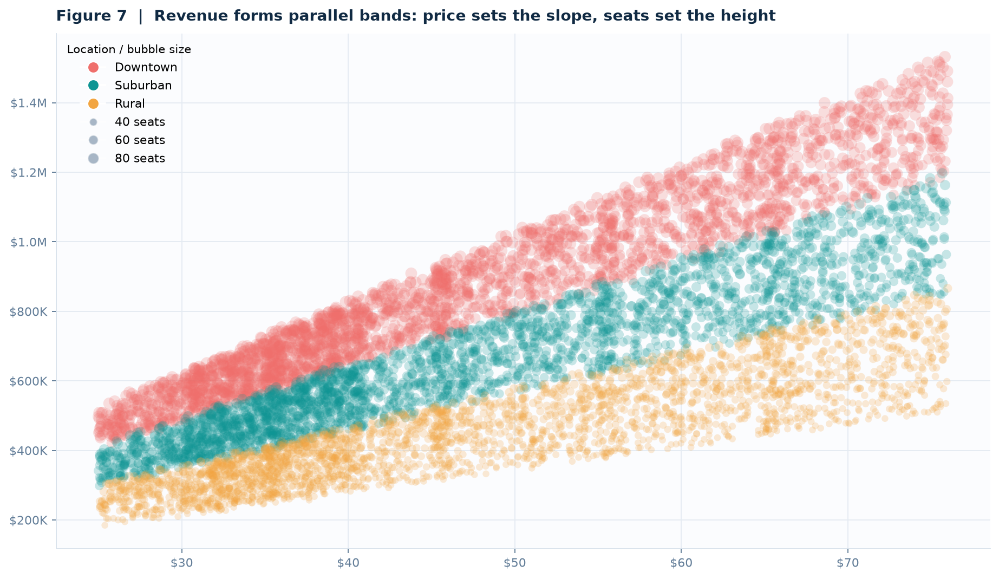
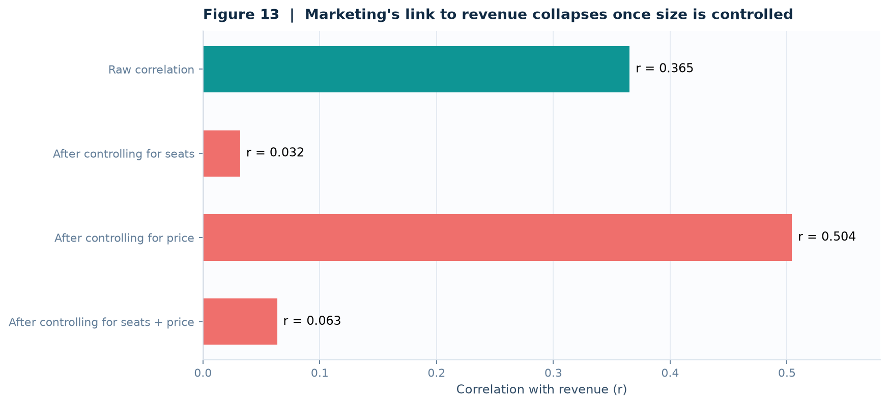
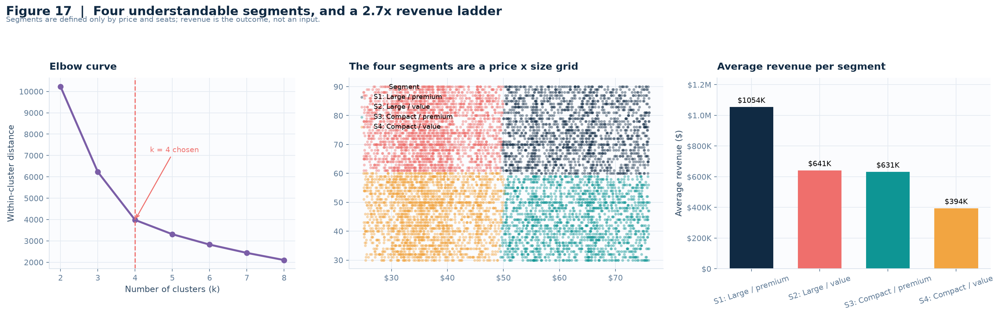
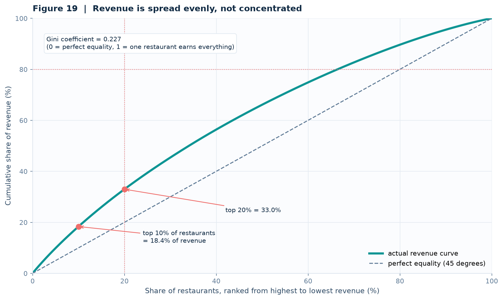

# Restaurant Revenue Analysis

**What actually drives revenue in 8,368 restaurants?**

An end-to-end exploratory data analysis and data-mining project: profiling, cleaning, outlier assessment, visualisation, statistical testing, segmentation and anomaly detection — finished with plain-English business insights.

[](https://colab.research.google.com/github/ConradNats/restaurant-revenue-analysis/blob/main/Restaurant_Data_Visualization.ipynb)


---

## The short version

I expected location, marketing and ratings to explain restaurant revenue. The data disagreed.

**Seats × average meal price explained 99.9% of revenue.** Location, cuisine and marketing were mostly proxies for those two. Marketing looked effective at first (r = 0.37), but after controlling for venue size the relationship collapsed to r = 0.06.

| # | Finding | Evidence |
|---|---|---|
| 1 | Revenue is a capacity × price equation | R² = **0.9993**, typical error **1.3%** |
| 2 | Marketing is confounded by venue size | r **0.37 → 0.06** after controls; extra R² **0.0002** |
| 3 | Ratings and service do not predict revenue | r between **−0.01 and +0.03**; flat rating bands |
| 4 | Cuisine is a price ladder | revenue per seat **$7,096 → $15,916** |
| 5 | Location is a size tier in disguise | 80 / 60 / 40 seats; revenue per seat within **4%** |
| 6 | Demand is price-insensitive here | r = **−0.02**; 0.96–0.99 bookings per seat |
| 7 | Four clear business segments | **2.7×** revenue ladder |
| 8 | Revenue is only mildly concentrated | Gini **0.227**; top 20% earn **33%** |
| 9 | No true anomalies | worst residual **±5.6%** |

> **One sentence:** revenue is a function of how many seats you have and what you charge per meal — everything else is either a proxy for those two or noise.

---

## Visual highlights

| Revenue is multiplicative | Marketing collapses after controls |
|---|---|
|  |  |

| Four structural segments | Revenue concentration |
|---|---|
|  |  |

All 19 charts are in [`figures/`](figures/), each with a consistent design system and direct labels.

---

## Business questions answered

| # | Question | Answer |
|---|---|---|
| Q1 | Which variables actually determine revenue? | Seats × price (R² = 0.999); other effects are negligible |
| Q2 | Does marketing spend pay off? | No evidence once size is controlled (r = 0.06) |
| Q3 | Is location or cuisine the real advantage? | Cuisine (price) is real; location is size in disguise |
| Q4 | Do ratings, reviews and service matter? | Not for revenue in this dataset |
| Q5 | Does a higher price reduce demand? | No — booking intensity is flat across price |
| Q6 | Are there hidden restaurant segments? | Four: large/compact × premium/value |
| Q7 | Which restaurants over- or under-perform? | None meaningfully; largest residual ±5.6% |
| Q8 | Is revenue concentrated in a few winners? | Mildly (Gini 0.227), not an 80/20 market |

The full reasoning, tests and charts are in the notebook.

---

## Repository structure

```text
.
├── Restaurant_Data_Visualization.ipynb   # main deliverable, fully executed
├── restaurant_data.csv                   # raw dataset (8,368 × 17)
├── restaurant_data_clean.csv             # cleaned + engineered dataset
├── figures/                              # 19 exported PNG charts
├── scripts/
│   ├── build_notebook.py                 # assembles the notebook from cell modules
│   ├── execute_notebook.py               # executes it in place (nbclient)
│   ├── nb_cells_part1.py                 # setup, profiling, cleaning, distributions
│   ├── nb_cells_part2.py                 # relationships, correlation, Q1–Q3
│   ├── nb_cells_part3.py                 # Q4–Q8, insights, deliverables, export
│   └── 01_profile.py … 04_segments.py    # standalone verification scripts
├── requirements.txt
├── LICENSE
└── README.md
```

---

## Getting started

### Option 1 — Google Colab (fastest, no install)

Click the **Open in Colab** badge at the top, then run all cells. If the dataset is not found, the notebook asks you to upload `restaurant_data.csv`.

> The badge assumes the repository is named `restaurant-revenue-analysis` under `ConradNats`. Update the URL if you choose a different name.

### Option 2 — Run locally

```bash
git clone https://github.com/ConradNats/restaurant-revenue-analysis.git
cd restaurant-revenue-analysis
pip install -r requirements.txt
jupyter notebook Restaurant_Data_Visualization.ipynb
```

### Option 3 — Rebuild and re-execute from source

The notebook is generated from three Python cell modules, so edits stay reviewable in plain Python:

```bash
python scripts/build_notebook.py
python scripts/execute_notebook.py
```

This overwrites the `.ipynb` with fresh outputs and saves all 19 charts to `figures/`.

---

## Dataset

`restaurant_data.csv` — 8,368 rows × 17 columns, no missing values and no duplicates.

| Group | Columns |
|---|---|
| Identifier | `Name` |
| Categorical | `Location`, `Cuisine`, `Parking Availability` |
| Venue | `Seating Capacity`, `Average Meal Price`, `Chef Experience Years` |
| Demand | `Weekend Reservations`, `Weekday Reservations` |
| Marketing | `Marketing Budget`, `Social Media Followers` |
| Reputation | `Rating`, `Number of Reviews`, `Avg Review Length`, `Ambience Score`, `Service Quality Score` |
| Outcome | `Revenue` |

Engineered features include total reservations, reservation rate, revenue per seat, revenue per marketing dollar, seats × price, rating band and price band.

---

## Method

1. **Profile** — shape, types, missing values, duplicates, range checks, category balance.
2. **Clean** — median/mode imputation policy, duplicate removal, logical validation.
3. **Outliers** — IQR and Z-score scan, visual inspection, sensitivity test. The outliers are genuine large venues on the same revenue line, so they are **kept and flagged**, not deleted or capped.
4. **Describe** — descriptive statistics, skew, histograms and boxplots.
5. **Visualise** — bar, line, pie, histogram, scatter, heatmap, bubble chart and Lorenz curve.
6. **Test** — R² comparison, multiple regression, partial correlation, ANOVA.
7. **Mine** — k-means segmentation (with elbow method) and residual/anomaly analysis.
8. **Explain** — plain-English insights, inputs/outputs, recommendations, limitations.

---

## Skills demonstrated

- Data cleaning and quality assessment on a real-world-shaped dataset
- Outlier reasoning: when to keep, cap or remove — and how to prove the choice is safe
- Statistical thinking: confounding, partial correlation, standardised regression, ANOVA
- Unsupervised learning: k-means with elbow selection and segment profiling
- Visual storytelling: 19 publication-quality charts with a consistent design system
- Communicating uncertainty and refusing to over-claim from cross-sectional data

---

## Limitations

- **The data appears synthetic.** Revenue follows a near-perfect formula (R² = 0.999), ratings are almost uniform, categories are perfectly balanced and followers are a fixed multiple of marketing budget. Findings describe *this file*, not the restaurant industry.
- **Cross-sectional only** — no time dimension, campaigns or seasonality.
- **Revenue is not profit** — costs, rent and labour are absent.
- **Correlation is not causation** — the regression shows association after controls.
- **Reservations are capped by seating capacity**, limiting demand analysis.
- Outliers were deliberately kept; the sensitivity check shows conclusions are stable either way.

These caveats are part of the deliverable, not an afterthought.

---

## Author

**Conrad Natuyamba**

- GitHub: [@ConradNats](https://github.com/ConradNats)
- LinkedIn: [www.linkedin.com/in/conrad-natuyamba-b87a12383](https://www.linkedin.com/in/your-profile/) <!-- update this link -->

Module 03 — Data Visualization milestone project.

---

## License

[MIT](LICENSE) — free to use, adapt and learn from.
